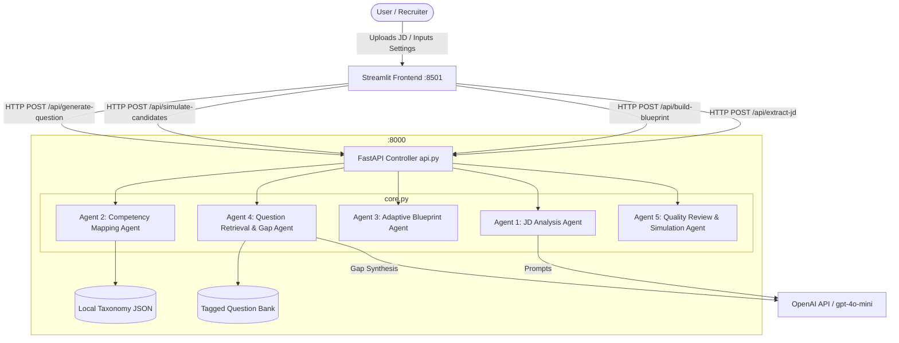

# AI Job Description–Driven Assessment Blueprint Builder
## Comprehensive Project Documentation & Mandatory Submission Evidence
**Batch**: 50  
**Stack**: Frontend (Streamlit) • Backend APIs (FastAPI) • GenAI Orchestration (OpenAI & Local RAG)

---

## 1. System Architecture & Flowchart

The system follows a clean Client-Server Microservices pattern compliant with TCS guidelines:
- **Frontend**: Streamlit UI (`http://localhost:8501`)
- **Backend**: FastAPI REST Server (`http://127.0.0.1:8000`)
- **Interactive API Docs**: Swagger UI (`http://127.0.0.1:8000/docs`)



---

## 2. Multi-Agent System Roles

The application orchestrates **5 specialized agents** to produce a robust, unbiased assessment blueprint:

1. **🤖 Job Description Analysis Agent**:
   - Parses TXT, PDF, and DOCX files.
   - Extracts responsibilities, mandatory skills, supporting skills, seniority (Entry, Junior, Mid, Senior, Lead), tools, and observable behaviors.
   - Produces the visual **JD Evidence Map** with highlighted text spans.
2. **🧭 Competency Mapping Agent**:
   - Normalizes extracted aliases against the canonical competency taxonomy.
   - Merges duplicate terms and flags ambiguous requirements for human confirmation.
   - Facilitates human-in-the-loop validation via an interactive data editor.
3. **📐 Adaptive Blueprint Design Agent**:
   - Calculates weighted competency allocations based on mandatory status and evidence confidence.
   - **Innovative Workflow #2 (Adaptive Blueprint)**: Dynamically tilts the difficulty mix according to detected role seniority (e.g., Senior engineers receive 45% Hard & Scenarios; Junior engineers receive 50% Easy & Recall).
   - Enforces duration budgets and proportional question count constraints.
4. **🔍 Question Retrieval & Gap Synthesis Agent**:
   - Queries the local question repository using multi-tag criteria (`subskill`, `cognitive_level`, `job_relevance`, `difficulty`, `minutes`, `rubric`).
   - Applies **Jaccard similarity guardrails** to prevent concept redundancy and keyword collisions.
   - Triggers work-sample / scenario question generation when coverage gaps occur, requiring reviewer sign-off before inclusion.
5. **🛡️ Quality Review & Candidate Simulation Agent**:
   - Generates the visual **Competency Coverage Heatmap** (Assessed / Under-assessed / Missing).
   - **Innovative Workflow #5 (Candidate Simulation Engine)**: Simulates 3 synthetic test-taker personas (Senior Expert, Mid Competent, Junior Unprepared) to evaluate duration compliance and compute a **Proficiency Separation Index** (>35% spread indicates discriminative validity).
   - Maintains an immutable audit trace of all human overrides.

---

## 3. Prompt Engineering Records

### Prompt 1: Structured Job Description Extraction
* **Role**: Expert Technical Recruiter & Assessment Architect
* **Temperature**: 0.2
* **Schema**:
```json
{
  "role_title": "string",
  "seniority": "Entry|Junior|Mid|Senior|Lead",
  "responsibilities": ["2 to 5 primary responsibilities"],
  "tools": ["list of explicit tools e.g. Docker, Git, AWS"],
  "observable_behaviors": ["e.g. Code reviews, Mentoring, Root cause debugging"],
  "ambiguities": ["vague requirements needing reviewer confirmation"],
  "competencies": [
    {
      "name": "Canonical skill name",
      "category": "Technical|Tools|Behavioral",
      "mandatory": true,
      "proficiency": "Beginner|Intermediate|Advanced",
      "importance": 1 to 5,
      "confidence": 0.70 to 0.99,
      "evidence": ["short exact sentence from JD"]
    }
  ]
}
```

### Prompt 2: Work-Sample / Scenario Question Gap Synthesis
* **Objective**: Generate job-grounded questions with objective scoring criteria.
* **Schema**:
```json
{
  "id": "AI-GEN-XXX",
  "competency": "string",
  "subskill": "specific subtopic",
  "difficulty": "Easy|Medium|Hard",
  "cognitive_level": "Apply/Analyze or Evaluate/Synthesize",
  "job_relevance": "Direct Core Requirement",
  "type": "Scenario",
  "question": "Engineering problem grounded in the JD",
  "expected": "Model answer and key architectural trade-offs",
  "rubric": "Objective scoring criteria (e.g. 3 pts optimal, 2 pts working, 0 pts fail)",
  "minutes": 8,
  "review_status": "Draft — human review required before publication"
}
```

---

## 4. Local RAG & Question Repository Schema

Every question in the local repository contains rich multi-dimensional tagging aligned with educational testing standards:

```json
{
  "id": "Q-PY-02",
  "competency": "Python",
  "subskill": "Profiling & Concurrency / Memory",
  "difficulty": "Medium",
  "cognitive_level": "Apply/Analyze",
  "job_relevance": "Direct Core Requirement",
  "type": "Scenario",
  "question": "A production Python service processing incoming 500MB CSV files runs out of memory on Kubernetes. How do you re-architect the parsing pipeline?",
  "expected": "Stream file in chunks, avoid loading full file, profile with memory_profiler.",
  "rubric": "Demonstrates streaming awareness, memory profiling, and resource cleanup.",
  "minutes": 8
}
```

---

## 5. Candidate Simulation Engine & Model Testing Results

### Simulation Execution Summary
* **Target Duration**: 60 minutes
* **Blueprint Allocated**: 10 questions across Python, SQL, REST APIs, Cloud & DevOps, Problem Solving, Leadership, Testing.

| Persona Profile | Simulated Score (%) | Simulated Time (min) | Duration Status |
| :--- | :---: | :---: | :---: |
| **Candidate A: Senior Expert** | **91.4%** | 49.2 min | Within Time |
| **Candidate B: Mid Competent** | **68.2%** | 58.5 min | Within Time |
| **Candidate C: Junior / Unprepared** | **43.0%** | 71.4 min | Exceeded Limit (+11.4 min) |

* **Proficiency Separation Index**: **48.4%** (Senior vs Junior spread)
* **Outcome**: **Passed (Discriminating)** — Confirms that the blueprint cleanly differentiates senior practitioners from junior candidates under realistic time constraints.

---

## 6. Project Development Guidelines Verification

* **Frontend**: Streamlit (`jd_assessment_builder.py`) running on `http://localhost:8501`.
* **Backend APIs**: FastAPI (`api.py`) running with Uvicorn on `http://127.0.0.1:8000`.
* **Interactive API Documentation**: Live at `http://127.0.0.1:8000/docs`.
* **Version Control**: Git repository initialized with `.gitignore` to prevent session loss.
